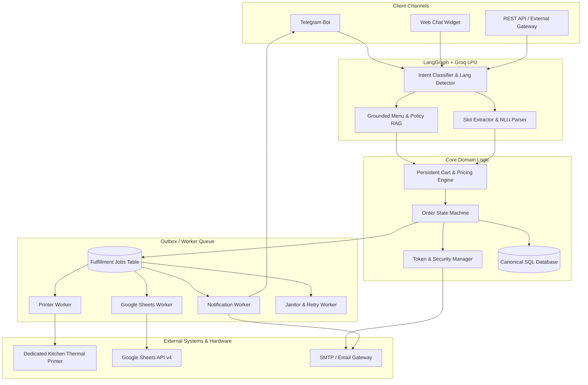
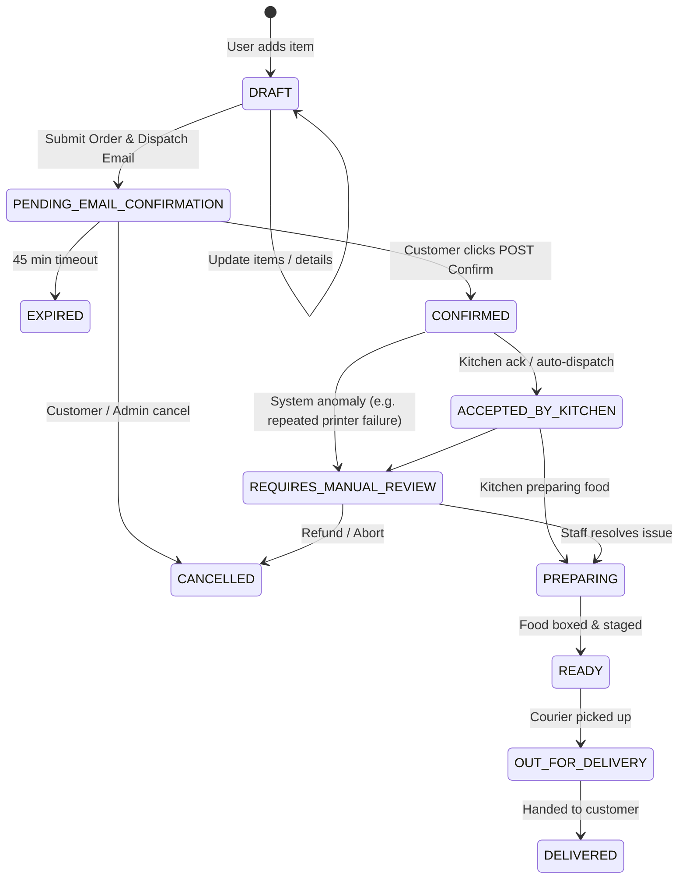
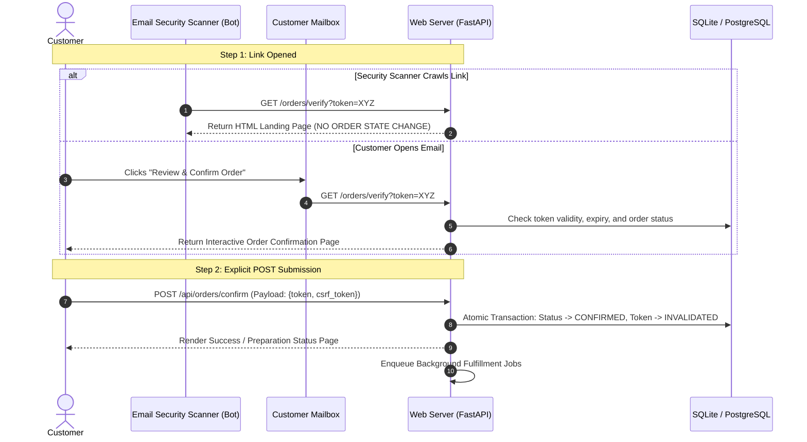
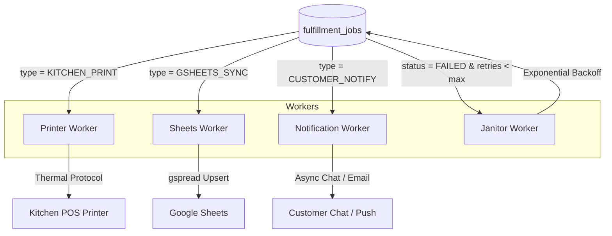
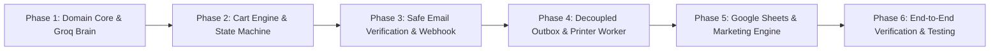

# AI Restaurant Agent: Production System Requirements, Architecture & Execution Specification (v2.0)

## 1. Executive Summary & Production Vision

The **AI Restaurant Agent** is a production-grade conversational hospitality and automated order fulfillment platform. It connects natural-language customer interactions across messaging channels (Telegram, Web, WhatsApp, REST) to physical kitchen printing operations, durable cloud reporting via Google Sheets, and targeted marketing re-engagement.

### Architectural Core Principles
1. **Strict Separation of Concerns**:
   * **Conversational Brain (LangGraph + Groq)**: Handles natural language understanding, multilingual intent classification, slot extraction, dish advisory, and customer empathy.
   * **Transactional Domain Service (FastAPI + SQLAlchemy)**: Authoritative owner of business logic, price calculations, order state transitions, availability checks, and token security. The LLM **never** directly commits order state or triggers physical side effects.
   * **Durable Background Fulfillment (Outbox / Worker Pattern)**: Physical printing, Google Sheets synchronization, and customer notifications run as independent, idempotent, retryable background tasks. A hardware failure at the kitchen printer never impedes or corrupts customer order confirmation or financial records.
2. **Database as Single Source of Truth**:
   * SQLite / PostgreSQL holds the canonical state, price snapshots, fulfillment queues, and audit logs.
   * Google Sheets is an asynchronous reporting and lead generation replica, not the primary database.
3. **Defense-in-Depth & Anti-Scanner Security**:
   * Two-phase email confirmation (GET landing page $\to$ explicit POST action) prevents email security crawlers (Proofpoint, Outlook Safe Links, Gmail bots) from prematurely triggering kitchen print jobs.
   * Strict idempotency guarantees that repeated clicks or network retries never generate duplicate receipts, double charges, or duplicate spreadsheet rows.

---

## 2. System Architecture & Separation of Concerns



---

## 3. Order & Fulfillment State Machine

To eliminate ambiguity and prevent race conditions, the system separates the **Business Order Lifecycle** from specific **Fulfillment and Payment Sub-states**.



### 3.1 Primary Business Statuses (`orders.status`)

| Status | Definition | Allowed Next Transitions |
| :--- | :--- | :--- |
| `DRAFT` | Cart actively being built or edited in conversation. | `PENDING_EMAIL_CONFIRMATION`, `CANCELLED` |
| `PENDING_EMAIL_CONFIRMATION` | All 6 slots verified; verification link dispatched to customer. | `CONFIRMED`, `EXPIRED`, `CANCELLED` |
| `CONFIRMED` | Email token validated via POST action; fulfillment jobs enqueued. | `ACCEPTED_BY_KITCHEN`, `REQUIRES_MANUAL_REVIEW`, `CANCELLED` |
| `ACCEPTED_BY_KITCHEN` | Order received by kitchen (via receipt print or staff dashboard). | `PREPARING`, `REQUIRES_MANUAL_REVIEW`, `CANCELLED` |
| `PREPARING` | Food is actively being prepared. | `READY`, `REQUIRES_MANUAL_REVIEW`, `CANCELLED` |
| `READY` | Packaging complete; awaiting courier pickup or table service. | `OUT_FOR_DELIVERY`, `DELIVERED` |
| `OUT_FOR_DELIVERY` | Handed over to delivery driver; customer notified. | `DELIVERED`, `REQUIRES_MANUAL_REVIEW` |
| `DELIVERED` | Terminal success state; order fulfilled. | None |
| `EXPIRED` | Verification token exceeded TTL (default 45 min) without confirmation. | `DRAFT` (if customer resumes / re-activates) |
| `CANCELLED` | Order terminated by customer request or staff intervention. | None |
| `REQUIRES_MANUAL_REVIEW` | Operational failure (e.g. invalid delivery address, persistent hardware failure). | `PREPARING`, `CANCELLED` |

### 3.2 Orthogonal Sub-Statuses
An order can be `CONFIRMED` even if the kitchen printer is temporarily offline. These sub-statuses track independent concerns:

1. **Email Verification Status (`email_verification_status`)**:
   * `UNVERIFIED` $\to$ `VERIFIED` $\to$ `EXPIRED`
2. **Payment Status (`payment_status`)**:
   * `PENDING_COD` (Cash on Delivery default) $\to$ `PAID` $\to$ `REFUNDED`
   * *Note*: Email confirmation verifies customer intent and contact legitimacy, **not** payment clearance.
3. **Print Status (`print_status`)**:
   * `PENDING` $\to$ `PRINTED` $\to$ `FAILED` $\to$ `REPRINTED`
4. **Google Sheets Sync Status (`sheets_sync_status`)**:
   * `PENDING` $\to$ `SYNCED` $\to$ `FAILED`

---

## 4. Conversational Flow & Smart Cart Management

### 4.1 Greeting & Progressive Menu Disclosure
* **No Menu Dumping**: The agent does **not** dump a 5,000-word menu on every greeting or returning turn.
* **First Interaction / Greeting**:
  * Greets warmly in the detected language (English or Bangla).
  * Presents popular featured categories:
    > *"Welcome to Dhaka Spice House! 🍛 We offer authentic Biryanis, sizzling Kebabs, Wings, Drinks, and Desserts. Would you like to see our **Chef Specials**, explore a **specific category**, or **order your favorite dish** right away?"*
  * Quick interactive category chips/buttons: `[🍛 Biryani & Mains]`, `[🍗 Wings & Appetizers]`, `[🥤 Drinks]`, `[🍰 Desserts]`.
* **Returning Customer Context**:
  * If a session has an ongoing cart or past order, the agent greets by name:
    > *"Welcome back, Rahim! You still have 2x Kachchi Biryani in your cart. Would you like to review your order or add anything else?"*

### 4.2 Multi-Turn Conversational Slot Filling
To finalize an order, the system requires 6 mandatory attributes. The agent collects them conversationally without interrogating the user with a single rigid questionnaire.

| # | Attribute | Type | Validation & Formatting Rules |
| :- | :--- | :--- | :--- |
| **1** | `items` | `List[OrderItem]` | Validated against database menu table (live price snapshot & stock check). |
| **2** | `quantities` | `Integer` | Positive integer ($\ge 1$). Default 1 if unspecified. |
| **3** | `customer_name` | `String` | Permissive international format: allows letters, spaces, hyphens, apostrophes, and Unicode / Bangla characters (`r"^[\p{L}\s\-\.'`]{2,80}$"`). |
| **4** | `customer_email`| `String` | Validated against standard RFC 5322 regex. |
| **5** | `customer_phone`| `String` | Sanitized phone string (local Bangladeshi `01XXXXXXXXX` or international E.164 standard). |
| **6** | `delivery_address`| `String` | Non-empty specific address (house, road, sector/area). |

#### Conversational Cart Mechanics:
1. **Persistent Session Cart**: Stored in the local database (`AgentSession` / `Cart`) keyed by `user_id` or `session_token`. Survives bot restarts and channel reconnections.
2. **Partial Updates**: Customer can say:
   * *"Add 2 Cokes"* $\to$ Appends items to active cart.
   * *"Remove one biryani"* $\to$ Decrements quantity.
   * *"Change my address to Road 12, Banani"* $\to$ Updates slot without resetting cart.
3. **Missing Slot Identification**:
   * The agent calculates `missing_slots = required_slots - filled_slots`.
   * Prompts naturally for only the missing attributes.
4. **Pre-Submission Order Recap**:
   * Before initiating email verification, the agent displays a clear, formatted summary:
     ```text
     📋 Order Review:
     - 2x Kachchi Biryani (Mutton) @ ৳350.00 = ৳700.00
     - 1x Borhani (500ml)          @  ৳90.00 =  ৳90.00
     ----------------------------------------------
     Subtotal:     ৳790.00
     Delivery Fee:  ৳60.00
     Grand Total:  ৳850.00 (Cash on Delivery)
     
     Deliver To:
     👤 John Doe | 📞 01711223344
     📍 House 12, Road 4, Dhanmondi, Dhaka
     ✉️ john@example.com
     
     Would you like to confirm this order, or make any changes?
     ```

---

## 5. Safe & Idempotent Email Verification Flow

### 5.1 Anti-Scanner Defense (GET $\to$ POST Architecture)
Email security systems (Proofpoint, Microsoft Defender, Google Safe Browsing) frequently pre-fetch links in incoming emails to check for malware. **A raw GET request must NEVER confirm an order.**



### 5.2 Verification Landing Page Features
1. **Order Recap Card**: Full line-item breakdown, grand total, delivery address, and payment method (Cash on Delivery).
2. **Explicit Confirmation Action**: Prominent button: `[ ✅ Confirm & Place Order ]`.
3. **In-Flight Corrections**:
   * If customer notices an error in their address or phone, they can click `[Edit Details]` right on the page.
4. **Token Expiry & Resend Recovery**:
   * If the token has expired, the page displays: *"This confirmation link has expired (45 min limit)."*
   * Customer can click `[ 🔄 Resend Verification Email ]` with 1 click without needing to re-enter their entire order in chat.

### 5.3 Idempotency Enforcement
* If `POST /api/orders/confirm` is called multiple times (e.g. user double-clicks, refreshes, or re-submits), the server checks the current status:
  * If already `CONFIRMED`, it immediately returns HTTP 200 with the existing confirmation payload and message: *"Your order is already confirmed and is currently being prepared!"*
  * **Zero duplicate kitchen tickets** and **zero duplicate Google Sheets rows** are generated.

---

## 6. Decoupled Fulfillment & Resilient Worker Architecture

### 6.1 The Outbox / Fulfillment Job Pattern
When an order transitions to `CONFIRMED`, the transaction atomically inserts three independent fulfillment jobs into the `fulfillment_jobs` table:

```sql
CREATE TABLE fulfillment_jobs (
    id INTEGER PRIMARY KEY AUTOINCREMENT,
    order_id INTEGER NOT NULL,
    job_type TEXT NOT NULL, -- 'KITCHEN_PRINT', 'GSHEETS_SYNC', 'CUSTOMER_NOTIFY'
    status TEXT NOT NULL DEFAULT 'PENDING', -- 'PENDING', 'PROCESSING', 'SUCCESS', 'FAILED'
    retry_count INTEGER NOT NULL DEFAULT 0,
    max_retries INTEGER NOT NULL DEFAULT 5,
    last_error TEXT,
    next_retry_at DATETIME,
    created_at DATETIME DEFAULT CURRENT_TIMESTAMP,
    updated_at DATETIME DEFAULT CURRENT_TIMESTAMP,
    FOREIGN KEY(order_id) REFERENCES orders(id)
);
```

### 6.2 Independent Workers
Each worker operates on its own schedule and lifecycle:



1. **Printer Worker (`KITCHEN_PRINT`)**:
   * Polls or receives pending print jobs.
   * Formats the receipt according to standard ESC/POS layout (80mm / 58mm).
   * Dispatches to printer. If connection drops or paper runs out:
     * Records `last_error` (e.g. `ConnectionRefusedError: Printer offline at 192.168.1.200:9100`).
     * Increments `retry_count` and applies backoff.
     * Generates an emergency local text/PDF snapshot in `data/receipts/`.
     * Does **not** block or fail Google Sheets sync or customer messaging!
2. **Google Sheets Worker (`GSHEETS_SYNC`)**:
   * Formats order and lead records.
   * Connects to Google Sheets API with token caching.
   * Performs an **idempotent upsert** matching on `Order ID`. If the row already exists, it updates status instead of creating duplicate lines.
   * Upserts the customer into `Leads_Master`.
3. **Notification Worker (`CUSTOMER_NOTIFY`)**:
   * Dispatches proactive confirmation message to customer's active chat channel (Telegram / Web):
     > *"🎉 Order Confirmed! Your order #ORD-20261014-001 has been sent to the kitchen. Estimated delivery time: 35-45 minutes."*
4. **Janitor & Monitoring Worker (`JANITOR_MONITOR`)**:
   * Runs periodically (e.g. every 5 minutes).
   * Identifies unconfirmed orders older than 45 minutes and transitions them to `EXPIRED`.
   * Flags orders stuck in `FAILED` print status to the restaurant admin dashboard with an audible or visual alert.

---

## 7. Ground-Truth Data Architecture & Schemas

### 7.1 Database Table Definitions (SQLAlchemy 2.0)

```python
from datetime import datetime
from decimal import Decimal
from sqlalchemy import (
    Column, Integer, String, Numeric, DateTime, ForeignKey, 
    Text, Boolean, Index
)
from sqlalchemy.orm import relationship, declarative_base

Base = declarative_base()

class MenuItem(Base):
    __tablename__ = "menu_items"
    id = Column(Integer, primary_key=True)
    item_code = Column(String(50), unique=True, index=True)
    name = Column(String(200), nullable=False)
    description = Column(Text)
    category = Column(String(100), index=True)
    price = Column(Numeric(10, 2), nullable=False) # Decimal safe
    is_available = Column(Boolean, default=True)
    image_url = Column(String(500))

class Order(Base):
    __tablename__ = "orders"
    id = Column(Integer, primary_key=True, autoincrement=True)
    order_code = Column(String(64), unique=True, index=True, nullable=False) # e.g. ORD-20261014-001
    user_id = Column(String(128), index=True, nullable=False) # Telegram user id / Web session id
    channel = Column(String(32), default="telegram") # telegram | web | whatsapp
    language = Column(String(8), default="en")
    
    # Customer Details (Ground truth snapshots)
    customer_name = Column(String(120), nullable=False)
    customer_email = Column(String(254), nullable=False, index=True)
    customer_phone = Column(String(32), nullable=False)
    delivery_address = Column(Text, nullable=False)
    special_notes = Column(Text, nullable=True)
    
    # Financial Snapshots (Decimal Precision)
    subtotal = Column(Numeric(10, 2), nullable=False)
    delivery_fee = Column(Numeric(10, 2), default=Decimal("60.00"))
    discount_amount = Column(Numeric(10, 2), default=Decimal("0.00"))
    total_amount = Column(Numeric(10, 2), nullable=False)
    
    # Status Machine
    status = Column(String(32), default="DRAFT", index=True)
    payment_status = Column(String(32), default="PENDING_COD")
    payment_method = Column(String(32), default="CASH_ON_DELIVERY")
    email_verification_status = Column(String(32), default="UNVERIFIED")
    print_status = Column(String(32), default="PENDING")
    sheets_sync_status = Column(String(32), default="PENDING")
    
    # Verification Token Security
    confirmation_token = Column(String(128), unique=True, index=True, nullable=True)
    token_expires_at = Column(DateTime, nullable=True)
    confirmed_at = Column(DateTime, nullable=True)
    
    # Timestamps
    created_at = Column(DateTime, default=datetime.utcnow)
    updated_at = Column(DateTime, default=datetime.utcnow, onupdate=datetime.utcnow)
    
    items = relationship("OrderItem", back_populates="order", cascade="all, delete-orphan")
    jobs = relationship("FulfillmentJob", back_populates="order", cascade="all, delete-orphan")

class OrderItem(Base):
    __tablename__ = "order_items"
    id = Column(Integer, primary_key=True)
    order_id = Column(Integer, ForeignKey("orders.id"), nullable=False)
    menu_item_id = Column(Integer, ForeignKey("menu_items.id"), nullable=True)
    item_name = Column(String(200), nullable=False)
    quantity = Column(Integer, nullable=False)
    unit_price = Column(Numeric(10, 2), nullable=False) # Frozen price at time of order
    line_total = Column(Numeric(10, 2), nullable=False)
    
    order = relationship("Order", back_populates="items")

class CustomerLead(Base):
    __tablename__ = "customer_leads"
    id = Column(Integer, primary_key=True)
    email = Column(String(254), unique=True, index=True, nullable=False)
    full_name = Column(String(120), nullable=False)
    phone = Column(String(32), nullable=False)
    delivery_address = Column(Text, nullable=True)
    total_orders = Column(Integer, default=1)
    lifetime_spend = Column(Numeric(12, 2), default=Decimal("0.00"))
    first_order_date = Column(DateTime, default=datetime.utcnow)
    last_order_date = Column(DateTime, default=datetime.utcnow)
    is_subscribed = Column(Boolean, default=True) # Marketing consent
    unsubscribed_at = Column(DateTime, nullable=True)
```

---

## 8. Dedicated Hardware Kitchen Printing Subsystem

### 8.1 Multi-Tier Driver Architecture
The printer service uses a driver adapter pattern with automatic failover:

```python
class BasePrinterAdapter(ABC):
    @abstractmethod
    def print_receipt(self, receipt_data: dict) -> bool:
        pass
    @abstractmethod
    def check_health(self) -> bool:
        pass
```

1. **Network ESC/POS Adapter (`NetworkPrinterAdapter`)**:
   * Direct raw TCP socket to thermal printer IP (e.g. `192.168.1.200:9100`).
   * Low latency, no driver required, standard for commercial POS printers (Epson TM-T88, Star, Xprinter).
2. **Windows Spooler Adapter (`Win32SpoolerAdapter`)**:
   * Uses `win32print` API to send RAW print stream to named Windows printer (e.g. `POS-80` or `EPSON TM-T20III`).
   * Ideal when the printer is connected via USB directly to the counter computer.
3. **Resilient File / PDF Fallback Adapter (`FileMockPrinterAdapter`)**:
   * Formats the receipt and saves it to `data/receipts/receipt_{order_code}.txt` and `.pdf`.
   * Triggered if physical printer is disconnected, enabling full local testing and zero order loss.

### 8.2 Standard Kitchen Receipt Format (80mm)
```text
================================================
              DHAKA SPICE HOUSE                 
          House 42, Road 11, Banani             
            Tel: +880 1700-000000               
================================================
ORDER CODE : #ORD-20261014-042
DATE/TIME  : 2026-10-14 14:32:10
STATUS     : CONFIRMED (EMAIL VERIFIED)
PAYMENT    : CASH ON DELIVERY (PENDING)
------------------------------------------------
CUSTOMER DETAILS:
Name       : John Doe
Phone      : +880 1711-223344
Address    : House 12, Road 4, Sector 3,
             Uttara, Dhaka
Notes      : Please provide extra mint sauce
------------------------------------------------
ITEMS ORDERED:
QTY   ITEM DESCRIPTION             PRICE   TOTAL
------------------------------------------------
 2 x  Kachchi Biryani (Mutton)    350.00  700.00
 1 x  Special Borhani (500ml)      90.00   90.00
 2 x  Firni Dessert                60.00  120.00
------------------------------------------------
SUBTOTAL:                                ৳910.00
DELIVERY FEE:                             ৳60.00
DISCOUNT:                                  ৳0.00
------------------------------------------------
GRAND TOTAL (TO COLLECT):                ৳970.00
================================================
          KITCHEN FULFILLMENT TICKET            
================================================
[Cut Paper Command \x1d\x56\x01]
```

### 8.3 Manual Reprint Control for Staff
* Admin endpoint: `POST /api/orders/{order_code}/reprint`
* Protected by admin API key / basic auth.
* Prints duplicate ticket clearly marked with `*** DUPLICATE / REPRINT ***` in the header to avoid accidental double food prep.

---

## 9. Day-by-Day Google Sheets Reporting & Lead CRM

### 9.1 Idempotent Upsert Strategy
Google Sheets is maintained as an operational dashboard. To prevent duplicate rows from retried tasks:
1. **Daily Order Worksheets (`Orders_YYYY-MM-DD`)**:
   * Worker checks for tab named `Orders_YYYY-MM-DD`. If missing, creates it with formatted headers:
     `[Timestamp, Order ID, Full Name, Email, Phone, Delivery Address, Items Ordered, Total Amount, Payment Method, Order Status]`
   * Checks column `B` (`Order ID`). If the `order_code` exists, **updates that row's status column**. If not found, appends a new row.
2. **Master Leads Directory (`Leads_Master`)**:
   * Columns: `[Email, Full Name, Phone Number, First Order Date, Last Order Date, Total Orders, Lifetime Spend, Subscribed]`
   * Matches on `Email`. If present: increments `Total Orders`, adds to `Lifetime Spend`, and updates `Last Order Date`.
   * If new customer: appends a fresh lead row with `Subscribed = TRUE`.

---

## 10. Promotional Marketing Broadcast Engine

### 10.1 Canonical API Specifications
* **Primary Broadcast Endpoint**: `POST /api/marketing/broadcast`
* **Alias Endpoint**: `POST /api/marketing/campaigns/send`
* **Campaign Preview Endpoint**: `POST /api/marketing/broadcast/preview`

```json
// POST /api/marketing/broadcast
// Headers: {"X-Admin-Api-Key": "secret_key"}
{
  "campaign_name": "Friday_Biryani_Feast_20_OFF",
  "subject": "🔥 20% Off Weekend Special at Dhaka Spice House!",
  "headline": "Special Treat for You, {{name}}!",
  "message_body": "Enjoy authentic Kachchi Biryani this weekend with a special 20% discount. Use promo code: BIRIYANI20.",
  "discount_code": "BIRIYANI20",
  "cta_text": "Order on Chat Now",
  "cta_url": "https://t.me/DhakaSpiceBot",
  "filter_criteria": {
    "min_orders": 1,
    "only_subscribed": true
  }
}
```

### 10.2 Delivery & Safety Safeguards
1. **Unsubscribe Link Compliance**: Every email includes a one-click unsubscribe URL:
   `https://<server>/api/marketing/unsubscribe?email=customer@example.com&token=HASH`
   Clicking marks `is_subscribed = FALSE` in SQLite and sets `Subscribed = FALSE` in Google Sheets `Leads_Master`.
2. **Admin Campaign Preview**:
   * Admin can preview rendered HTML and send a test email to a designated staff address before sending to the entire list.
3. **Throttled Batch Dispatch**:
   * Dispatches at a rate of 25 emails/minute with jitter to prevent SMTP provider rate-limiting and ensure high deliverability (inbox vs spam).
4. **Broadcast Audit Report**:
   * Returns: `{ "total_leads": 150, "eligible_subscribed": 142, "sent": 142, "failed": 0, "duration_sec": 340 }`.

---

## 11. Security, Resilience, & Error Recovery Matrix

| Scenario / Risk | Impact | Resilient Mitigation Strategy |
| :--- | :--- | :--- |
| **Email Security Crawler** | False confirmation & premature kitchen print | **Two-phase verification**: GET displays interactive page; explicit customer POST with CSRF token confirms order. |
| **Email Token Expiration** | Customer clicks link after 45 minutes | Landing page shows friendly expired notice with `[Resend Verification Link]` button; cart is not lost. |
| **Kitchen Printer Offline / Jammed** | Kitchen misses food prep | Order remains `CONFIRMED`. Printer worker marks `print_status = FAILED`, writes fallback receipt to disk, and triggers admin dashboard alert. Other workers continue unaffected. |
| **Google Sheets API Rate Limit** | Sheet logging rejected | Exponential backoff retry queue (`fulfillment_jobs`); local SQLite retains ground truth permanently. |
| **Customer Name with Special Characters** | Valid names rejected | Permissive regex allowing letters, spaces, hyphens, apostrophes, and Unicode / Bengali characters. |
| **Menu Price Updates Mid-Session** | Price mismatch / dispute | Database snapshots `unit_price` at the exact moment of order placement. Historical orders are immutable. |
| **Duplicate Confirmation Clicks** | Double charging or repeat prints | Transactional idempotency check: repeated calls return current order state without re-queuing fulfillment jobs. |
| **Chat Disconnection / Page Refresh** | User loses active cart | Cart state persisted in database session table; automatically restored when conversation resumes. |

---

## 12. Systematic Implementation Roadmap



### Phase Breakdown

#### Phase 1: Environment & Brain Upgrade
* Update dependencies in `requirements.txt`: `groq`, `langchain-groq`, `gspread`, `python-escpos`, `aiosmtplib`, `jinja2`, `pywin32`.
* Expand `app/config.py` with Groq API settings, SMTP configs, printer endpoints, and Google service account keys.
* Configure Groq LLM factory (`llama-3.3-70b-versatile` for slot extraction & intent; `llama-3.1-8b-instant` for general dialogue).

#### Phase 2: Domain Database & Cart State Machine
* Implement updated SQLAlchemy models: `Order`, `OrderItem`, `MenuItem`, `CustomerLead`, `FulfillmentJob`.
* Build transactional `OrderService`:
  * Validates cart against database menu items.
  * Calculates decimal-safe totals.
  * Manages state machine transitions.
* Update LangGraph flow:
  * Progressive greeting without full menu dump.
  * Natural multi-turn slot filling with missing slot tracker.
  * Explicit pre-confirmation order summary.

#### Phase 3: Safe Email Verification & Webhook
* Implement cryptographic token generator and expiry validator.
* Create branded, responsive HTML verification email templates with `[Review & Confirm Order]` action.
* Implement verification endpoints:
  * `GET /orders/verify`: Renders interactive confirmation landing page.
  * `POST /api/orders/confirm`: Idempotent confirmation endpoint triggering transition to `CONFIRMED`.
  * `POST /api/orders/resend-verification`: Link recovery endpoint.

#### Phase 4: Decoupled Outbox & Dedicated Printer Subsystem
* Implement `FulfillmentJob` outbox dispatcher.
* Build `app/services/printer.py`:
  * `NetworkPrinterAdapter` (TCP 9100).
  * `Win32SpoolerAdapter` (Windows RAW spooler).
  * `FileMockPrinterAdapter` (local text & PDF fallback).
* Build kitchen ticket template (80mm).
* Implement staff manual reprint endpoint: `POST /api/orders/{order_code}/reprint`.

#### Phase 5: Google Sheets & Marketing Broadcast Module
* Build `app/services/sheets.py` with idempotent upsert into `Orders_YYYY-MM-DD` and `Leads_Master`.
* Build `app/services/marketing.py`:
  * Canonical endpoint `POST /api/marketing/broadcast` (with preview mode).
  * Rate-throttled async email delivery.
  * Unsubscribe webhook handler (`/api/marketing/unsubscribe`).

#### Phase 6: System Testing & Production Validation
* Unit test order state machine transitions.
* Simulate email scanner GET crawling (confirming no state change occurs).
* Test printer offline fallback & auto-recovery.
* Test Google Sheets upsert deduplication.
